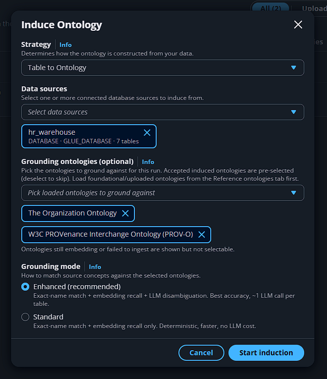

Use ohi to load standard ontologies into AWS [Context Ontology Accelerator](https://github.com/aws/context-ontology-accelerator) (COA). It builds an ontology from your data, and based on loaded reference ontologies reuses existing terms instead of making up new ones. Here we will use [W3C Organization](https://ohi.dev/o/w3c/org@2014) and [PROV-O](https://ohi.dev/o/w3c/prov-o@2013).

To use other ontologies, search on [ohi.dev](/docs/guides/search/) or use `ohi search`. 

## How ohi and COA work together

1. `ohi add` downloads the ontologies you choose as OWL Turtle (`.ttl`) files. It records them in `ohi.yaml` and pins the exact files in `ohi.lock.json`.
2. You upload the files to COA, which calls them *reference ontologies*.
3. COA builds its ontology from your data in a step called *induction*. During induction, it links your classes to matching terms in the reference ontologies with `rdfs:subClassOf` or SKOS match links. COA calls this *grounding*. A `staff` table can then point to an existing class instead of becoming a new `Staff` class.
4. Because the lock file pins the exact files, anyone can run `ohi sync` to get the same ones and load them into another COA namespace or account.

## Before you begin

- [ohi installed](/docs/getting-started/install/).
- [COA deployment](https://github.com/aws/context-ontology-accelerator/blob/main/external-docs/content/deploying.md).
- A COA user with the `platform-admin` role, or `namespace-owner` on an existing namespace.
- At least one data source registered in that namespace.

## Download the ontologies with ohi

1. Create a project that downloads OWL Turtle files into an `ontologies` folder:

   ```sh
   ohi init coa-ontologies --default_format owl-turtle --to ontologies
   cd coa-ontologies
   ```

2. Add your ontologies:

   ```sh
   ohi add w3c/org@2014
   ohi add w3c/prov-o@2013
   ```

   Each one lands in its own folder, such as `ontologies/w3c/org/2014/`, along with any ontologies it depends on.

3. Check that the files are there:

   ```sh
   find ontologies -name '*.ttl'
   ```

   In PowerShell, use `Get-ChildItem ontologies -Recurse -Filter *.ttl`. You should see one file per ontology, plus one per dependency.

4. Commit `ohi.yaml` and `ohi.lock.json`. Anyone who runs `ohi sync` in this folder then gets the same files, checked against the same checksums. See [Manage ontology projects](/docs/guides/projects/) for more.

## Create a namespace in COA

Skip this if you already have one.

1. Log in to the COA console as a `platform-admin` user.
2. Go to **Administration** > **Namespaces** > **Create namespace**.
3. Enter required data and choose a language.
4. Click **Create namespace**, **Confirm namespace language**, then click **Confirm and create**.

## Upload the reference ontologies to COA

1. In the COA console, open your namespace and go to **Ontology** > **Induction**.
2. In the ontology upload area, upload each `.ttl` file from `ontologies/`.
3. Check that they all appear on the **Reference ontologies** tab.

## Start induction with your ontologies

1. On the **Induction** page, click **Start induction**.
2. Leave **Strategy** as **Table to Ontology**.
3. Under **Data sources**, select your data sources.
4. Under **Grounding ontologies (optional)**, select the reference ontologies you uploaded. If you have accepted an induction result in this namespace before, the console selects that one too. Leave it like that.
5. Click **Start induction**.



## Check that COA used your ontologies

COA shows the ontology it suggests as a *proposal*. When induction finishes, open it. Classes that match your reference ontologies now link to their terms. In the example, those links point to IRIs starting with `http://www.w3.org/ns/org#` or `http://www.w3.org/ns/prov#`.

If nothing links:

- Check that you selected the reference ontologies before starting induction.
- Your tables may not match them. Try ontologies closer to your data.

## Keep the ontologies up to date

To move to a newer version, change it in `ohi.yaml` (`ohi inspect <ontology_id>` shows the latest) and run `ohi sync`. Upload the new files, delete the old ones on **Explorer** > **Ontologies**, and run induction again.

## Clean up

- To remove just the ontologies, delete them in **Explorer** > **Ontologies**.
- To remove a test deployment, run `make destroy-dev` in your COA clone. It may take some time to delete.

## Get help

NeverBlink, the team behind ohi, maintains this guide, not AWS. If something does not work, open an [ohi issue](https://github.com/NeverBlink-OSS/ohi/issues) or ask on [Discord](https://discord.gg/DNZXS35cd2). For problems with COA itself, use the [COA issue tracker](https://github.com/aws/context-ontology-accelerator/issues).

## Resources

- [ohi.dev ontology catalog](https://ohi.dev/)
- [ohi on GitHub](https://github.com/NeverBlink-OSS/ohi)
- [COA on GitHub](https://github.com/aws/context-ontology-accelerator)
